# Venue Lost & Found

Lost-and-found for venues: staff log found items, the public searches a redacted listing and files lost reports,
claims are verified with challenge questions built from private details, and admins see inventory, chain of custody and analytics.

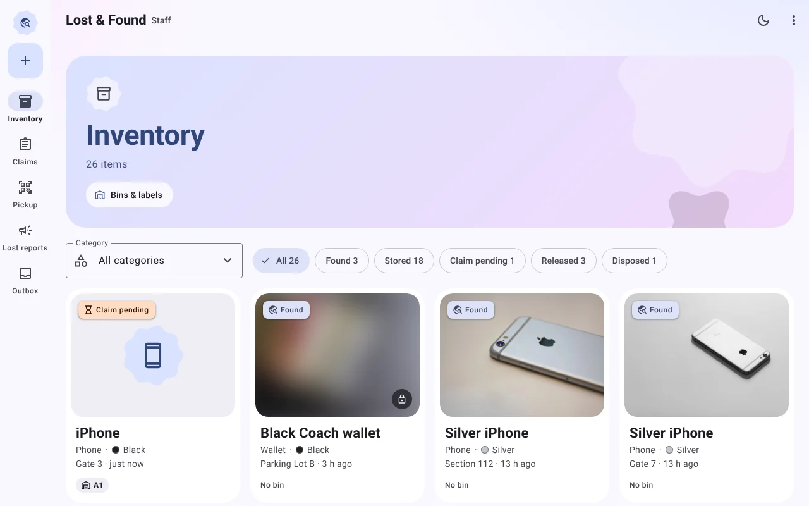

Requires Node 22.12 or newer. If `npm install` prints "install scripts blocked" (npm 12), that is fine: the SQLite binary ships prebuilt.

```bash
npm install
npm run seed   # demo data
npm run dev    # http://localhost:5173  (API :3001)
npm test
```

- Demo script: [DEMO.md](./DEMO.md)  ·  Developer guide: [AGENTS.md](./AGENTS.md)  ·  Backlog: [TASKS.md](./TASKS.md)
- Logins: `staff@venue.test` / `admin@venue.test`, password `demo1234`.

## Features

Mobile-first Material 3 (Expressive) UI with light and dark themes. Fonts, icons and photos are all vendored, so it runs fully offline.
Screenshots come from the seeded demo data and follow the [DEMO.md](./DEMO.md) flow.

### Public search, redacted by design

Visitors browse what staff have found. Listings show only public details (item name, category, color, area, day);
photos and private details are never sent to the browser, and a leak test guards this.
Each item uses its **name as the heading**, with the category as a caption and filter.

<table><tr>
<td>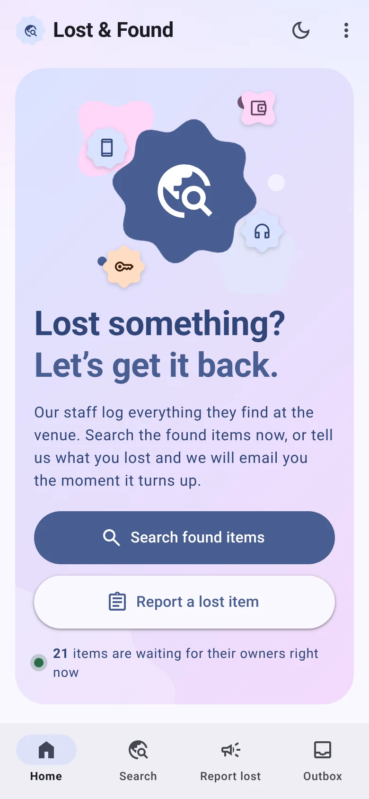</td>
<td>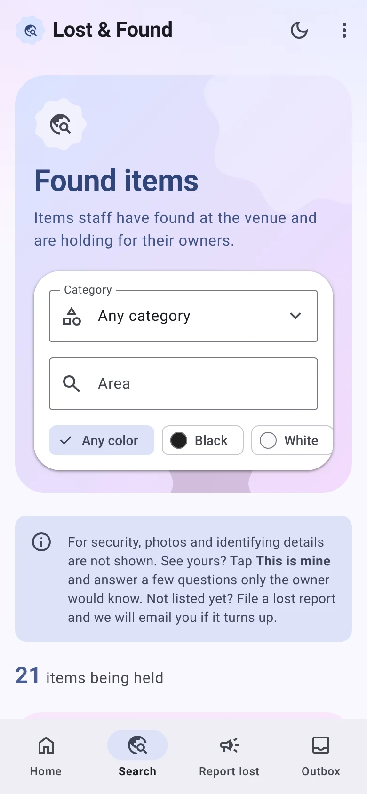</td>
<td>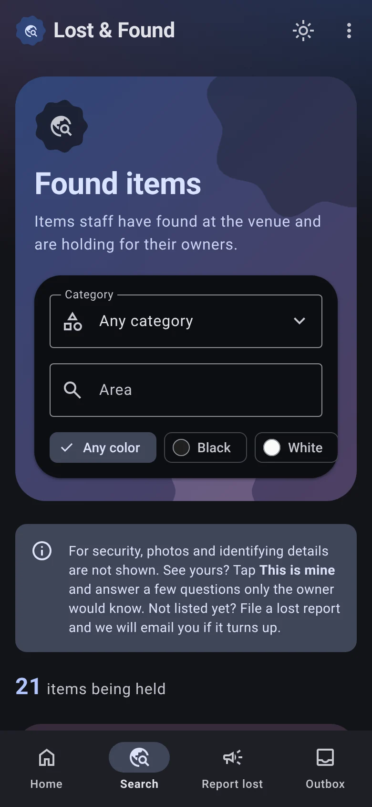</td>
</tr><tr>
<td align="center">Home</td><td align="center">Found items</td><td align="center">Dark theme</td>
</tr></table>

### "This is mine" claims with challenge questions

Tapping **This is mine** asks for an email and opens the claim page. Questions are generated from the item's
private fields (model, case, lock screen, damage...), so only the owner should know the answers.
Claims are rate limited per item and links use hashed one-time tokens.

<table><tr>
<td>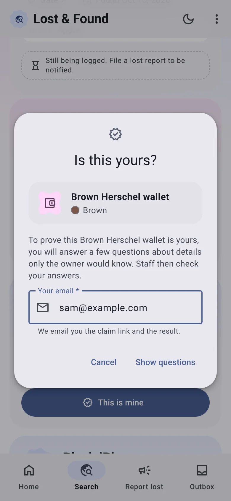</td>
<td>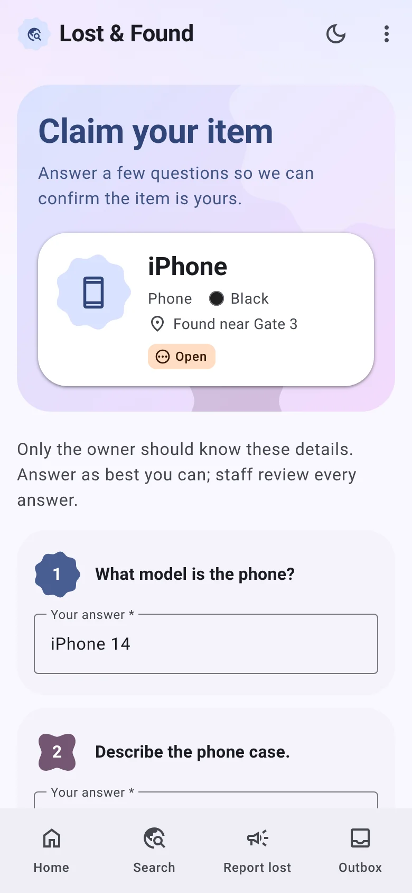</td>
</tr><tr>
<td align="center">Start a claim</td><td align="center">Answer verification questions</td>
</tr></table>

### Lost reports and automatic matching

Visitors who don't see their item file a lost report. When staff log an item, it is scored against open reports
(category, color, area and time window); a strong match emails the visitor a claim link.
Emails and texts never leave the machine: they land in the dev **Outbox**.

<table><tr>
<td>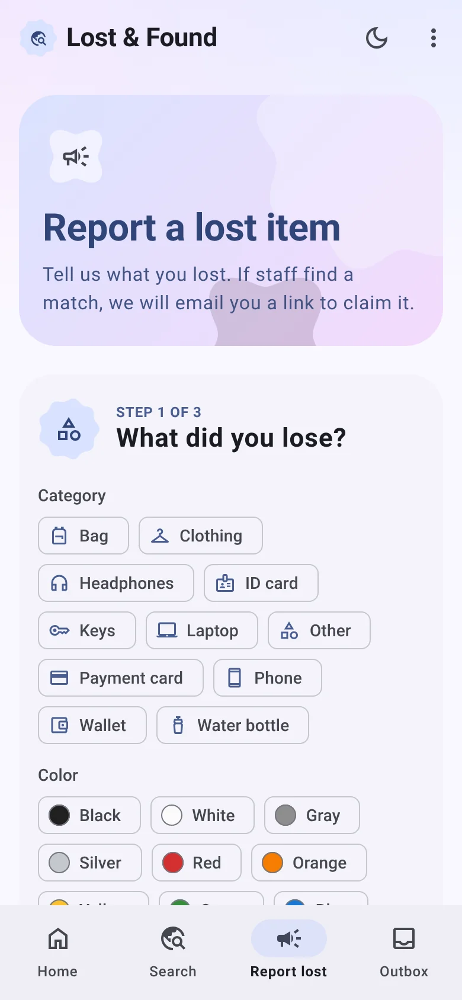</td>
<td>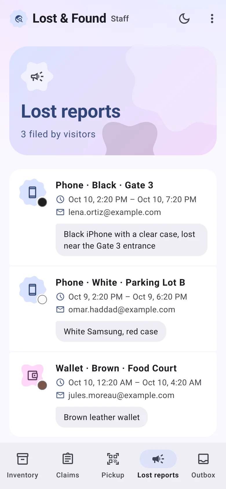</td>
<td>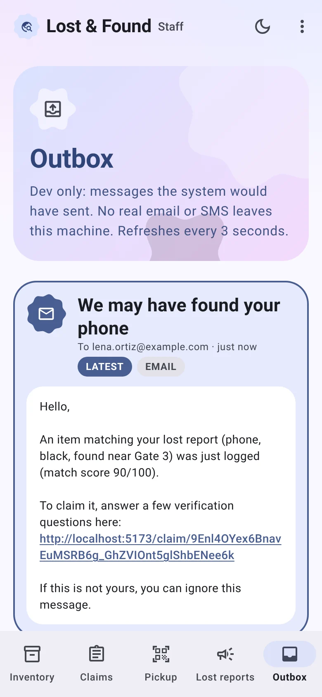</td>
</tr><tr>
<td align="center">Report a lost item</td><td align="center">Staff view of reports</td><td align="center">Match email in the Outbox</td>
</tr></table>

### Fast staff intake and inventory

Logging an item takes about 20 seconds on a phone: photo, category, item name, color, where, and category-specific details.
Public fields appear in the listing; private ones become claim questions. Optionally, a **local** vision model
pre-fills the form from the photo (see below). The inventory filters by category and state and shows each item's bin.

<table><tr>
<td>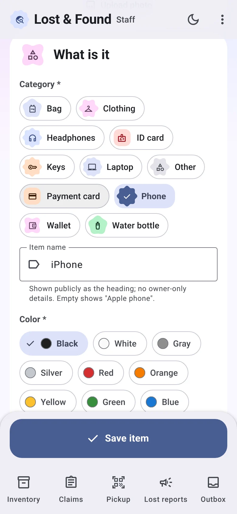</td>
<td>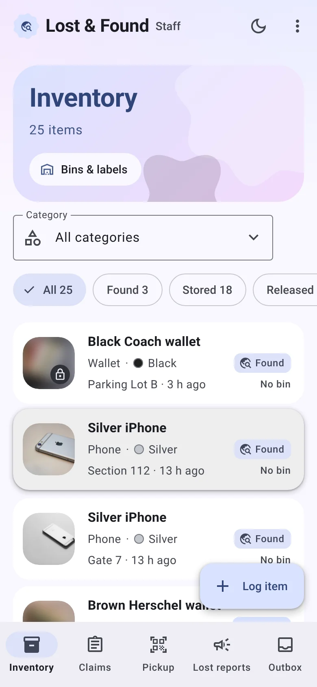</td>
</tr><tr>
<td align="center">Log found item</td><td align="center">Inventory</td>
</tr></table>

Categories are plugins: one file in `shared/src/categories/defs/` adds fields, privacy, challenge questions,
sensitivity and retention (phone, wallet, keys, bag, clothing, ID card, payment card, laptop, water bottle, headphones, other).

### Claim review with forgiving answer matching

Staff see the claimant's answers next to the private record. Matching tolerates typos, word order, plurals and filler words
("my cat wearing a sweater" matches "cat in a sweater") while numbers must match exactly; each answer is marked Match, Close or Differs.

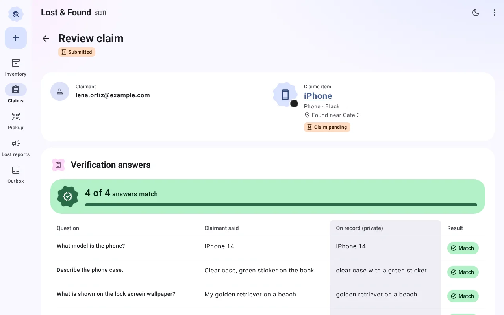

### One-time pickup QR and chain of custody

An approved claimant gets a pickup QR code. At the desk, staff scan it (or type the code), check photo ID and release the item;
the code then stops working. Every state change (found, stored, claim pending, verified, released, disposed) is written to the item's
custody log with who and when.

<table><tr>
<td>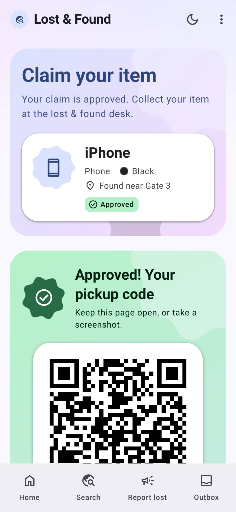</td>
<td>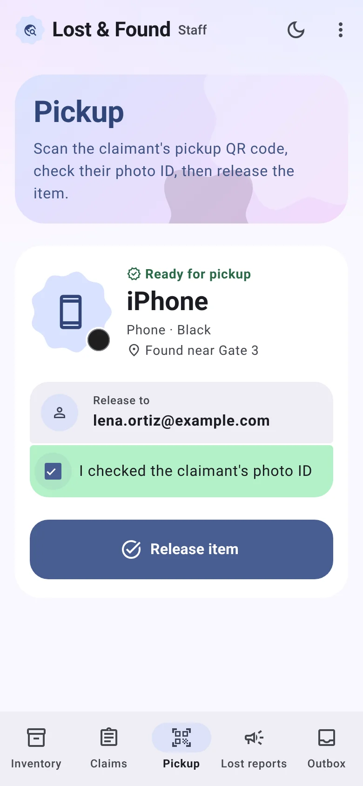</td>
<td>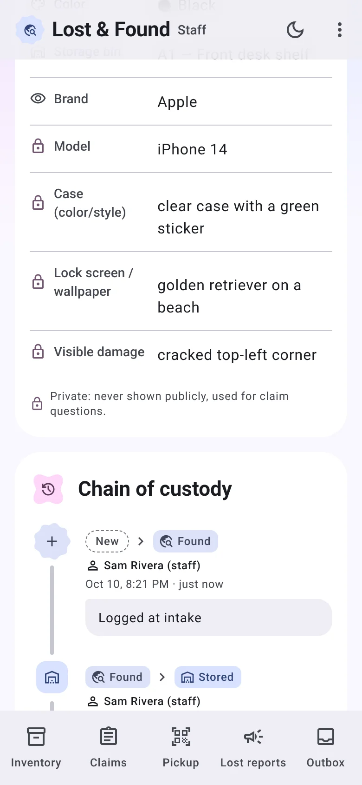</td>
</tr><tr>
<td align="center">Claimant's pickup code</td><td align="center">Release at the desk</td><td align="center">Chain of custody</td>
</tr></table>

### Admin dashboard and retention

Admins see items logged, return rate, median time to return, claim approvals, inventory by state, hot spots and bin usage.
Items kept past their category's retention period are flagged for disposal, which is also logged in the custody chain.

<table><tr>
<td>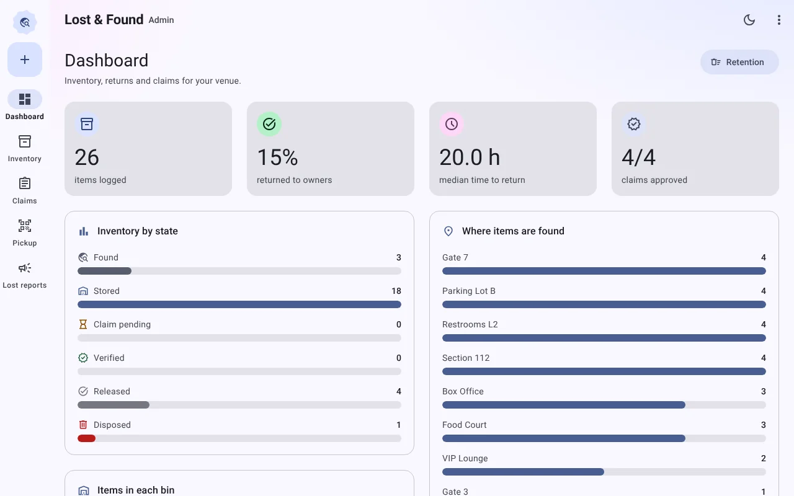</td>
<td>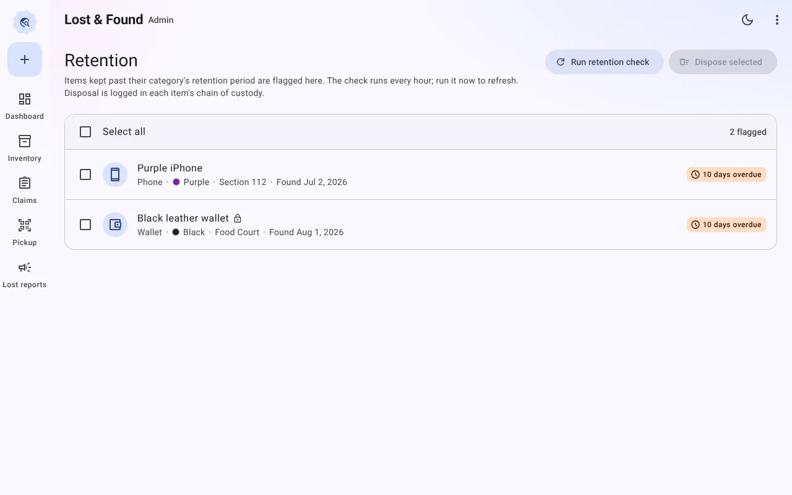</td>
</tr><tr>
<td align="center">Dashboard</td><td align="center">Retention</td>
</tr></table>

## Optional: fill intake from a photo (local AI, no internet)

On **Log item**, staff can take or upload a photo and the form pre-fills category, color and details
(only empty fields; staff check before saving). The photo is read by a vision model **on your own machine**
through an OpenAI-compatible endpoint. Without one running, the form simply works by hand.

```bash
# Ollama (default endpoint http://localhost:11434/v1)
ollama pull qwen2.5vl:7b
ollama serve            # if it is not already running
npm run dev

# or LM Studio: load a vision model, start its server, then
VISION_URL=http://localhost:1234/v1 VISION_MODEL=<model id> npm run dev
```

Settings (env): `VISION_URL` (`off` disables), `VISION_MODEL` (default `qwen2.5vl:7b`), `VISION_TIMEOUT_MS` (default 60000).

